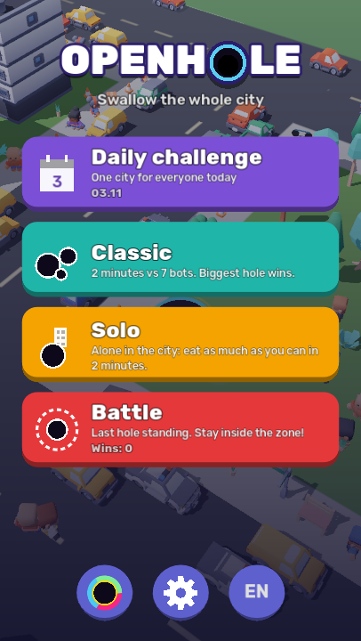
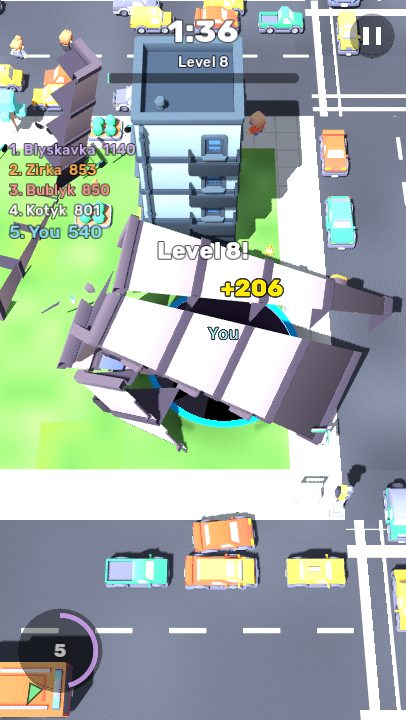
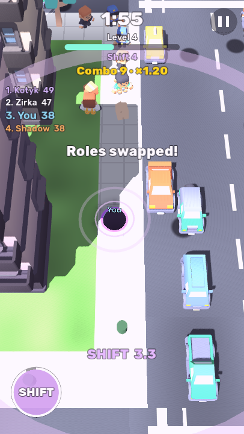

# OpenHole


Open source (MIT) game in the spirit of hole.io: you are a hole in the ground
that swallows a procedurally generated city. Built with Godot 4.7 for Android
(also runs on PC and in the browser).

<p>
  
  
  
</p>

## Game Off 2026 — Theme: SHIFT
OpenHole is our entry for [GitHub Game Off 2026](https://itch.io/jam/game-off-2026).
The theme is read as a **shift of roles**: a hole either hunts or is hunted, and
one button swaps the two. The small one becomes the danger.

**Shift** (button in the bottom-left corner, `Shift` key on PC), for 3.5 s:
- the hole shrinks to 0.45× its size and moves 25 % faster;
- nobody can eat it, and the Battle zone does not hurt it;
- it eats nothing of the city (things already falling in are worth 0 points);
- it swallows **any** other hole once it dives into its inner half, however big (shielded ones are safe),
  for the usual points;
- other power-ups are paused until it ends.

A swallowed hole implodes into a shockwave that cracks nearby buildings and throws chunks around.

Then 8 s of cooldown (ready again right after a respawn). Bots close by freeze for
a moment in surprise and then run. Shift works in every mode; there is no separate
mode for it. The very first match shows a one-time hint pointing at the button.

On Normal difficulty bots have their own Shift too, but use it sparingly (about
once per half a minute); on Hard they use it freely: they slip away from a bigger
hole or dive into one. A Shift kill by the player gets a brief slow-motion close-up, and
every hole-vs-hole event lands in the small kill feed. In Classic the shift-eaten
bot comes back out for revenge and hunts the player for 20 s. Shift kills in
quick succession build a swap chain worth up to +100 % points. Shift kills also
count towards the Phase skin.

## Modes
- **Classic** — 2 minutes vs 7 bots, biggest hole wins. Eaten holes respawn.
- **Solo** — alone, eat as much of the city as you can in 2 minutes.
- **Battle** — last hole standing; the safe zone shrinks.

- **Daily challenge** — Solo on a city that is the same for everyone that day,
  with a twist of the day (Sprint, No power-ups, Power rain or Head start);
  the menu card also counts the Shifts you used on it today. Three daily missions
  (listed in the stats screen) are judged on any match you play that day.

Power-ups: magnet, speed, giant (+2 levels for a while), shield (cannot be eaten),
and two instant ones that only the player can take: time (+10 s, not in Battle)
and freeze (stops every bot for 3 s, not in Solo). Timed ones pause while you are shifted.
Eating things quickly in a row builds a combo (up to +50 % points).
Skins for your hole unlock with records. Settings: sound, vibration, camera shake,
FPS counter, graphics quality, left-handed layout, screen flashes, joystick size and
sensitivity, bot skill and count, map theme (day city, warm suburb, night, sandy
Mexico City or winter) and seed. The results screen copies a short result code
(`OH1-C-<seed>-<points>`) to share with friends.
The Low preset is for weaker phones: 30 FPS, no dynamic shadows, simpler ground
and half as many particles, while physics and game rules stay unchanged. After
six sustained seconds below 24 FPS, the game suggests this preset once; it never
switches automatically.

A how-to-play sheet opens on the first launch and from the `?` button. The stats
screen keeps lifetime counters, per-mode records, a daily streak and 15 achievements.
Solo counts the city by value (a skyscraper is worth more than a pedestrian) and
awards bronze, silver and gold.

Buildings, buses, rocks and big trees break into chunks and collapse into the hole.
A hole too small for a skyscraper can still bite chunks off it.

## What's new in 0.8
- Daily twists (Sprint, No power-ups, Power rain, Head start) and three daily missions.
- A copyable result code on the results screen.
- Instant Time (+10 s) and Freeze power-ups, and a Winter map theme.
- Joystick size and sensitivity settings.
- Battle fixes: bonuses and bots stay inside the shrinking zone, no false win when eliminated.
- Saving is batched and atomic, and an unreadable save is kept as a backup.

## What's new in 0.7
- The Low preset targets weaker phones: 30 FPS, no dynamic shadows, simpler ground and half as many particles.
- Graphics quality changes apply immediately, including during a match; physics and game rules stay unchanged.
- Sustained low FPS triggers a one-time suggestion to try Low, never an automatic switch.
- Shift blasts no longer cut building meshes synchronously, and the final volume adjustment is saved reliably.

## Download
Get the APK from [GitHub Releases](https://github.com/dsidxavekko/openhole/releases).
Releases since 0.6.0 use the same release key and can update in place. Versions
0.5.5 and older were debug-signed: uninstall them first, which erases the local
save. Android asks to allow installing from unknown sources.

## Build
Requirements: Godot 4.7 (`~/.local/opt/godot/godot`), Android SDK build-tools,
JDK 17+, debug keystore (`~/.local/opt/debug.keystore`). Paths can be overridden
via `make GODOT=... ANDROID_HOME=... KEYSTORE=...`.

```sh
make test     # headless logic tests
make smoke    # full bot-driven match without graphics (MODE=classic|solo|battle|daily)
make apk      # build/openhole.apk
make install  # adb install + launch on a connected phone
make web      # browser build in out/web (itch.io), make serve-web to try it
make run-pc   # play on PC (WASD / arrows or a gamepad, mouse drag = joystick, Shift / X = Shift, Esc / Start = pause)
# screenshots: godot --path . --rendering-driver opengl3 -- --screenshot=menu.png [--shot-sheet=skins]
# in a match with Shift: ... -- --autoplay --mode=classic --screenshot=shift.png --shot-shift [--lang=en]
```

## How swallowing works
The ground is one solid collider; holes are drawn by cutting circles out in the
ground shader. When an object fits and overlaps a hole, its collision mask drops
the ground layer and it gets a push towards the middle, so it tips over and falls
through. Below the surface it is eaten and the hole gets points.

## How things fall apart
`Fracture` (`scripts/world/fracture.gd`) cuts a model into irregular chunks with
random planes and caps every cut; this runs on a worker thread when a match
starts. `Demolition` (`scripts/world/demolition.gd`) swaps a breakable object for
its chunks: all at once when it fits the hole, or frozen in place when only a
chunk fits. Each chunk knows which chunks rest on it, so when the hole takes the
ones underneath, the unsupported ones above come down; chunks keep a fraction of
the original object's `weight` so the "city eaten" percentage counts whole city
objects no matter how often things were broken up.

## License
Code: MIT (see `LICENSE`). 3D models: Kenney, CC0. Font: Rubik, SIL OFL 1.1.
Details in `CREDITS.md`.
