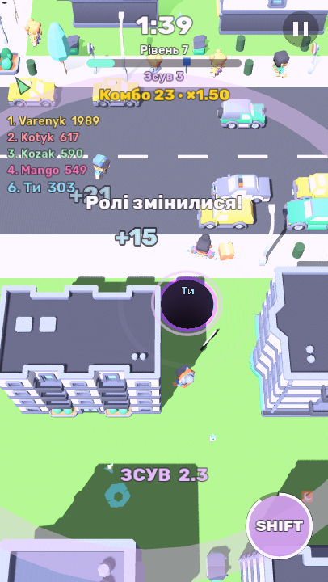

# OpenHole

Open source (MIT) game in the spirit of hole.io: you are a hole in the ground
that swallows a procedurally generated city. Built with Godot 4.7 for Android
(also runs on PC and in the browser).

## Game Off 2026 — Theme: SHIFT
OpenHole is our entry for [GitHub Game Off 2026](https://itch.io/jam/game-off-2026).
The theme is read as a **shift of roles**: a hole either hunts or is hunted, and
one button swaps the two. The small one becomes the danger.

**Shift** (button in the bottom-right corner, `Shift` key on PC), for 2.5 s:
- the hole shrinks to 0.45× its size and moves 25 % faster;
- nobody can eat it, and the Battle zone does not hurt it;
- it eats nothing of the city (things already falling in are worth 0 points);
- it swallows **any** other hole it dives into, however big (shielded ones are safe),
  for the usual points;
- other power-ups are paused until it ends.



Then 6 s of cooldown (ready again right after a respawn). Bots close by freeze for
a moment in surprise and then run. Shift works in every mode; there is no separate
mode for it.

## Modes
- **Classic** — 2 minutes vs 7 bots, biggest hole wins. Eaten holes respawn.
- **Solo** — alone, eat as much of the city as you can in 2 minutes.
- **Battle** — last hole standing; the safe zone shrinks.

- **Daily challenge** — Solo on a city that is the same for everyone that day.

Power-ups: magnet, speed, giant (+2 levels for a while), shield (cannot be eaten).
They pause while you are shifted.
Eating things quickly in a row builds a combo (up to +50 % points).
Skins for your hole unlock with records. Settings: sound, vibration, camera shake,
FPS counter, bot skill and count, map theme and seed.

Buildings, buses, rocks and big trees break into chunks and collapse into the hole.
A hole too small for a skyscraper can still bite chunks off it.

## Download
Get the APK from [GitHub Releases](https://github.com/dsidxavekko/openhole/releases).
It is debug-signed, so Android asks to allow installing from unknown sources.

## Build
Requirements: Godot 4.7 (`~/.local/opt/godot/godot`), Android SDK build-tools,
JDK 17+, debug keystore (`~/.local/opt/debug.keystore`). Paths can be overridden
via `make GODOT=... ANDROID_HOME=... KEYSTORE=...`.

```sh
make test     # headless logic tests
make smoke    # full bot-driven match without graphics (MODE=classic|solo|battle|daily)
make apk      # build/openhole.apk
make install  # adb install + launch on a connected phone
make web      # browser build in out/web (itch.io), make serve-web to try it
make run-pc   # play on PC (WASD / arrows, mouse drag = joystick, Shift = Shift)
# screenshots: godot --path . --rendering-driver opengl3 -- --screenshot=menu.png [--shot-sheet=skins]
# in a match with Shift: ... -- --autoplay --mode=classic --screenshot=shift.png --shot-shift
```

## How swallowing works
The ground is one solid collider; holes are drawn by cutting circles out in the
ground shader. When an object fits and overlaps a hole, its collision mask drops
the ground layer and it gets a push towards the middle, so it tips over and falls
through. Below the surface it is eaten and the hole gets points.

## How things fall apart
`Fracture` (`scripts/world/fracture.gd`) cuts a model into irregular chunks with
random planes and caps every cut; this runs on a worker thread when a match
starts. `Demolition` (`scripts/world/demolition.gd`) swaps a breakable object for
its chunks: all at once when it fits the hole, or frozen in place when only a
chunk fits. Each chunk knows which chunks rest on it, so when the hole takes the
ones underneath, the unsupported ones above come down.

## License
Code: MIT (see `LICENSE`). 3D models: Kenney, CC0. Font: Rubik, SIL OFL 1.1.
Details in `CREDITS.md`.
